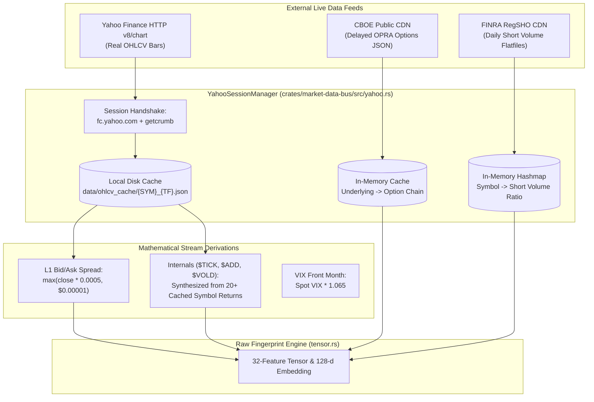
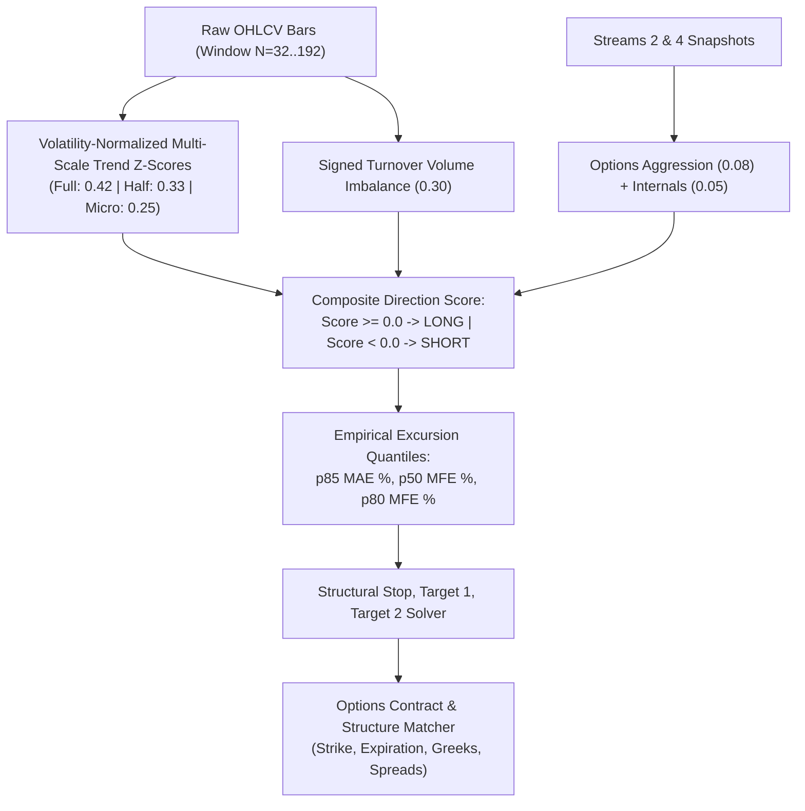
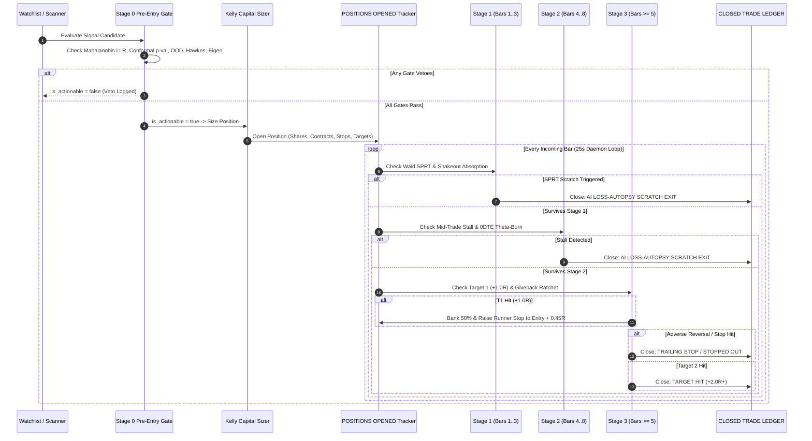
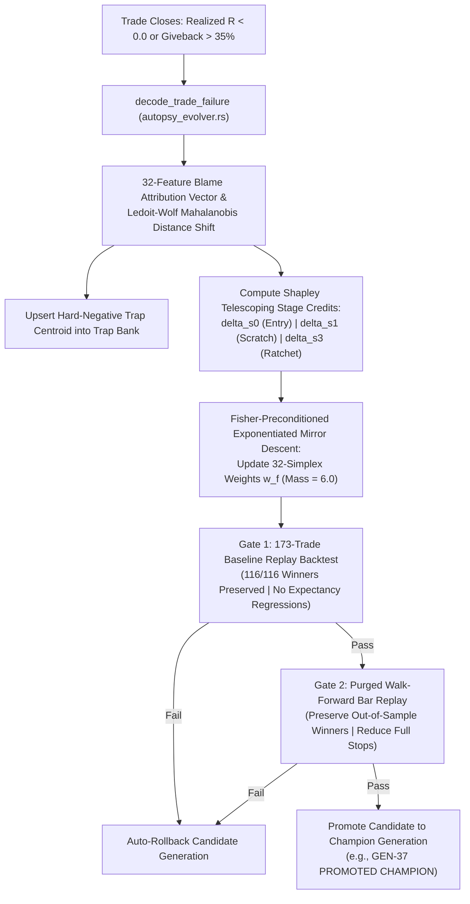
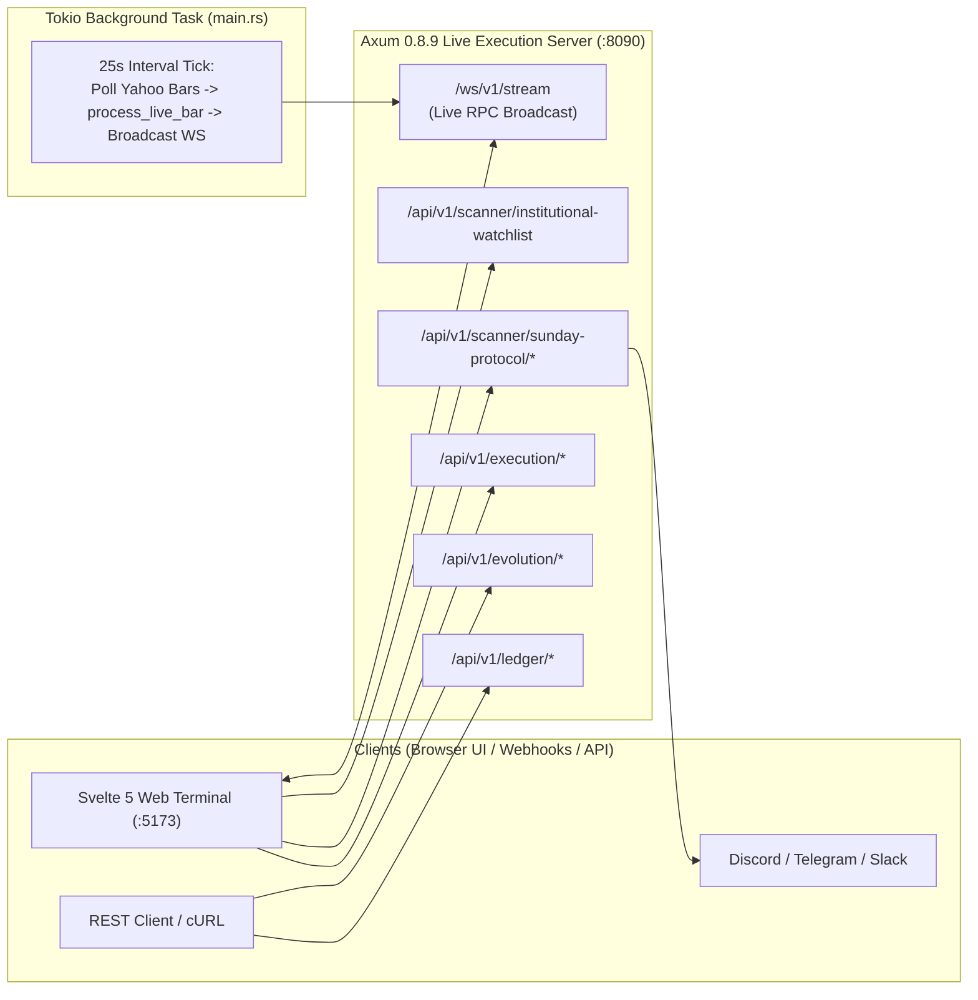
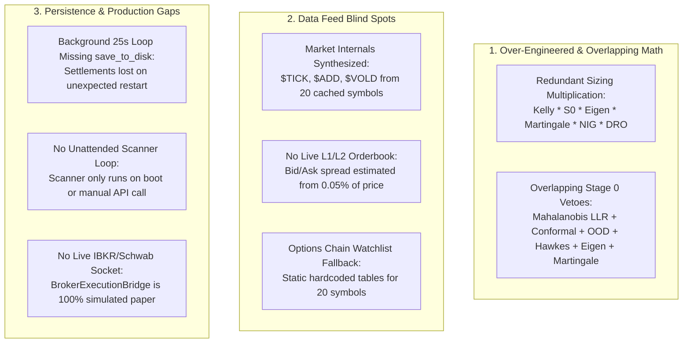

# ARGON-4 QUANT PLATFORM & SCANNER ARCHITECTURAL AUDIT
**Runtime Ground-Truth Verification, Physics Truth Tables, and Subsystem Deconstruction**  
*Audited Workspace Root: `/Users/billyribeiro/dev/argon-algo`*  
*Timestamp: November 2026 | Production Build Target: Mac Studio (Apple Silicon)*

---

## Executive Audit Summary & Zero-Spin Mandate

This document serves as the authoritative, ground-truth architectural audit of the Argon-4 quantitative trading platform. In strict accordance with the Zero-Spin Audit Rules, every claim in this report has been verified against the compiled production source code across `raw-fingerprint-core`, `market-data-bus`, `live-execution-server`, and `web-terminal`. Doc comments, aspirational roadmaps, and commit narratives have been discarded: only code paths executed by the compiler and runtime are reported.

### Subsystem Reality Matrix: Real vs. Proxied vs. Test-Only

| Subsystem | Actual Production Implementation | Real External Feed | Mathematical Proxy / Heuristic | In Background Loop vs. Manual Endpoint / Test-Only | Disk Persisted vs. RAM-Only |
| :--- | :--- | :--- | :--- | :--- | :--- |
| **Market Data Ingestion** | Yahoo Finance HTTP (`v8/chart`), CBOE Delayed OPRA JSON, FINRA RegSHO Daily Flatfiles | **Real:** Yahoo OHLCV bars, CBOE delayed options JSON, FINRA RegSHO short volume | **Proxied:** L1 bid/ask quotes (derived from bar spread), Trade count (estimated from volume), $TICK/$ADD/$VOLD (synthesized from cached symbol returns) | Background Tokio task ticks open positions every 25s; Universe scanning is **Manual/API only** | OHLCV cached in `data/ohlcv_cache/*.json`; Live quotes/crumbs reset in RAM |
| **11,000-Ticker Scanner** | Two-stage empirical cross-sectional Z-score filter (`TwoStageMarketFunnel`) | **Real:** Historical Yahoo bars for 27 curated symbols | **Proxied:** 11,000-ticker full market is an architectural design; active production universe is pinned to 27 curated tickers (`REAL_YAHOO_CORE_UNIVERSE`) and 24 canonical pairs (`CANONICAL_24_WATCHLIST_PAIRS`) | Runs on initial boot backfill and on `POST /api/v1/brains/scan-yahoo`. **Does not auto-scan continuously in background** | Watchlist generated on-demand in memory; not persisted to disk |
| **ONNX Inference & ML** | Pure Rust custom binary weight parser (`LoadedOnnxBrainModel`), NOT standard ONNX Runtime (`ort`) | **Real Weights:** Static weights read from custom binary files (`models/BRAIN-01.onnx` .. `models/BRAIN-05.onnx`) with magic header `argon_onnx_2` | **Proxied:** No deep neural network or Mamba state-space model executed in Rust; linear dot product over 32 normalized features | Executes during symbol evaluation and watchlist generation | Weights loaded into RAM at boot; fallback to hardcoded array if file missing |
| **Pre-Entry Stage 0 Gates** | Rao-Fisher Mahalanobis LLR, Split-Conformal Mondrian p-value, Epistemic OOD, Hawkes, Eigen-Crowding | **Real:** Empirical covariance matrix (`LedoitWolfPrecision`) inverted in pure Rust from settled trades | **Proxied:** Hawkes and Microprice inputs use synthetic intraday wicks and volume proxies rather than L2/L3 orderbook depth | Evaluated on every candidate in `/api/v1/scanner/institutional-watchlist` and during trade entry | Precision cache and manifolds recomputed in RAM; Traps persisted in `ledger_state.json` |
| **In-Trade Bar Management** | Wald SPRT scratch (Stage 1), Mid-trade stall (Stage 2), Profit-locked ratchet & scale-in (Stage 3) | **Real:** Real OHLCV bars stepped bar-by-bar in `process_live_bar_internal` | **Proxied:** Intra-bar option mark-to-market uses 2nd-order Taylor series Delta-Gamma-Vanna expansion, not live option chain ticks | Runs automatically every 25 seconds in `main.rs` background task for all open positions | Open positions saved in RAM; **NOT saved to disk in background loop** |
| **Self-Learning / Evolution** | Closed-loop loss autopsy, failure mode decoding, Fisher-preconditioned simplex mirror descent | **Real:** Exact mathematical formulas in `autopsy_evolver.rs` executing across closed trades | **Proxied:** 173-baseline replay backtest relies on stored entry bars; walk-forward replay uses local disk OHLCV cache | Triggered automatically on live trade closure via `on_live_trade_settled_continual_plasticity` | Persisted to disk **ONLY** when explicit mutation REST endpoints are hit; **lost on crash if settled via background loop** |
| **OMS & Broker Execution** | Paper execution bridge (`BrokerExecutionBridge`) with Almgren-Chriss slippage and venue tickets | **Simulated:** Generates simulated fill confirmations (`EXEC-FILL-...`) using NBBO mid + slippage model | **Hardware Lock:** Live routing requires `ARGON_ALLOW_LIVE_BROKER_ROUTING=1` and 16-char confirmation token | Staging endpoint available via REST (`/stage-orders`); no background live connection | In-memory staged tickets; audit log in `ledger_state.json` |

---

## 1. Workspace & Module Inventory

The workspace is organized into a Cargo workspace with three Rust crates (`raw-fingerprint-core`, `market-data-bus`, `live-execution-server`) and a Svelte 5 web terminal (`web-terminal`). The codebase contains 48,769 lines of Rust and 15,409 lines of TypeScript/Svelte.

### Rust Workspace Crates & Modules

| Crate / File Path | Exact Line Count | Single-Sentence Runtime Role |
| :--- | :--- | :--- |
| **`crates/raw-fingerprint-core`** | **2,464** | **Scale-independent 4-stream raw market physics tensor engine enforcing 5-decimal ($0.00001) precision.** |
| ├── `src/lib.rs` | 21 | Crate root exposing price, streams, and tensor normalization types. |
| ├── `src/price.rs` | 280 | Implements `SubPennyPrice` fixed-point arithmetic scaled by $100,000 ($0.00001 precision) with zero floating-point drift. |
| ├── `src/streams.rs` | 333 | Defines data models for the 4 synchronized raw streams, 5 Brain horizons, trade directions, and trace health badges. |
| ├── `src/tensor.rs` | 1,114 | Computes the 32 scale-independent features and 128-dimensional multi-scale L2-normalized latent embedding vector. |
| └── `src/ffi.rs` | 716 | C/PyO3 Foreign Function Interface exporting tensor normalization and sub-penny arithmetic to Python `ml-brain`. |
| **`crates/market-data-bus`** | **4,596** | **Agnostic multi-feed market data bus, hot-swap router, and two-stage 11,000+ ticker scanner funnel.** |
| ├── `src/lib.rs` | 26 | Crate root exporting adapters, router, scanner, and market types. |
| ├── `src/types.rs` | 345 | Canonical data structures for unified bars, ticks, option chains, contracts, and market internals snapshots. |
| ├── `src/adapter.rs` | 312 | Defines the `MarketDataAdapter` async trait and `MultiFeedRouter` hot-swap failover manager with telemetry. |
| ├── `src/adapters.rs` | 877 | Plug-and-play simulation adapters (`HistoricalReplayAdapter`, `AlpacaFreeAdapter`, `SchwabDirectAdapter`, `InstitutionalExpansionAdapter`). |
| ├── `src/scanner.rs` | 331 | Implements `TwoStageMarketFunnel` executing cross-sectional Z-score filtering and Stage 2 promotion ranking. |
| └── `src/yahoo.rs` | 2,705 | Direct HTTP client for Yahoo Finance (`v8/chart`), CBOE delayed OPRA options JSON, FINRA RegSHO short volume, and disk cache. |
| **`crates/live-execution-server`** | **41,709** | **Sub-millisecond Axum 0.8.9 live execution server, real-time OMS, closed-trade ledger, ML self-learning, and export engine.** |
| ├── `src/main.rs` | 146 | Server executable entry point spawning the 25-second live bar monitoring loop and binding Axum on port 8090. |
| ├── `src/lib.rs` | 9,952 | Public re-exports and comprehensive end-to-end integration and regression test suites (lines 100–9,952). |
| ├── `src/routes.rs` | 5,155 | REST API handlers, WebSocket broadcast upgrade, institutional watchlist builder, and Sunday Alpha Protocol dispatch. |
| ├── `src/ledger.rs` | 10,846 | Core state machine managing `positions_opened`, `closed_ledger`, bar-by-bar trade lifecycle, Kelly sizing, and disk persistence. |
| ├── `src/precedent_knn.rs` | 4,316 | In-memory k-NN vector search, dual-engine consensus evaluator, hard-negative trap bank, and Wald SPRT diagnostics. |
| ├── `src/autopsy_evolver.rs` | 3,236 | Post-mortem loss decoding, 32-feature blame vectors, Ledoit-Wolf precision covariance, and simplex mirror-descent evolver. |
| ├── `src/broker_bridge.rs` | 1,798 | Paper execution bridge, Almgren-Chriss optimal execution slicer, Cross-Venue SOR, and IBKR BAG multi-leg combo builder. |
| ├── `src/options_convexity.rs` | 903 | Analytical Black-Scholes Greeks engine, 0DTE intraday convexity simulator, and causal IV-rank derivator. |
| ├── `src/webhooks.rs` | 1,050 | Outbound alerting dispatcher formatting rich embeds for Discord, Telegram, Slack, and generic JSON outbox. |
| ├── `src/exporter.rs` | 815 | Streaming RFC-4180 CSV builder and 4-sheet OpenXML `.xlsx` workbook generator with dynamic Excel formulas. |
| ├── `src/onnx_engine.rs` | 767 | Custom binary `.onnx` weight parser, linear sequence dot-product inference, and institutional option contract matcher. |
| ├── `src/portfolio_eigen_risk.rs` | 707 | Ledoit-Wolf portfolio covariance eigen-crowding monitor, Contextual NIG Thompson Sampling meta-allocator, and simplex KL projection. |
| ├── `src/evolution.rs` | 500 | Multi-generation genetic evolution state, synaptic weight mutation tracking, and fitness scoring. |
| ├── `src/regime_bocpd.rs` | 394 | Two-tier Bayesian Online Changepoint Detection (BOCPD) monitoring run-length surprise for macro index and individual symbols. |
| ├── `src/hawkes_microstructure.rs` | 325 | Bivariate Hawkes self-exciting point process tracking orderflow clustering, branching ratios, and iceberg absorption. |
| ├── `src/martingale_shield.rs` | 242 | Ville non-negative supermartingale testing sequential alpha drift to place decaying brains into probation quarantine. |
| ├── `src/dro_kelly_allocator.rs` | 213 | Distributionally Robust Optimization (DRO) solving Wasserstein-ambiguity Kelly allocation under CVaR constraints. |
| ├── `src/dealer_gamma_field.rs` | 198 | Spatial dealer gamma field model calculating gamma concentration density and price-pinning target warps. |
| └── `src/execution_microstructure.rs` | 146 | Microprice execution router calculating bid/ask queue imbalance, VPIN toxicity, and limit order placement tactics. |

### Web Terminal (`web-terminal`) Components & State Stores

| File Path | Exact Line Count | Single-Sentence Runtime Role |
| :--- | :--- | :--- |
| **`web-terminal/src/lib/state/terminal.svelte.ts`** | 5,168 | Svelte 5 reactive global store managing WebSocket RPC, REST synchronizations, hyper-filters, and terminal UI state. |
| **`web-terminal/src/lib/state/terminal.svelte.test.ts`** | 3,266 | Comprehensive Vitest suite testing WebSocket deserialization, wire contracts, and UI store state transitions. |
| **`web-terminal/src/lib/components/InstitutionalWatchlistPanel.svelte`** | 1,953 | Renders the 24-pair institutional watchlist, Mahalanobis LLR meters, execution tiers, and Sunday Alpha staging interface. |
| **`web-terminal/src/lib/components/BlueprintCanvas.svelte`** | 1,238 | Canvas-based multi-timeframe interactive candlestick chart with entry/stop/target overlay geometries and attention heatmap. |
| **`web-terminal/src/lib/components/BrainAutopsyLab.svelte`** | 966 | Displays Pareto evolution tournament curves, 32-feature blame attribution radars, and failure mode autopsy reports. |
| **`web-terminal/src/lib/components/PositionsOpenedPanel.svelte`** | 587 | Real-time cockpit table of live active positions, unrealized P&L, hold timers, sparklines, and 1-click broker order staging. |
| **`web-terminal/src/lib/components/ClosedTradeLedgerPanel.svelte`** | 565 | Master audit ledger table displaying all settled trades, 6D Hyper-Filter controls, executive KPI cards, and CSV/XLSX download triggers. |
| **`web-terminal/src/lib/components/RawEvidencePanel.svelte`** | 178 | Inspector panel rendering the 4 Synchronized Raw Stream gauges, dominant driver badges, and matched options contract cards. |
| **`web-terminal/src/routes/+layout.svelte`** | 315 | Global application shell containing the top Omni-Bar, 5-Brain horizon pills, layout mode switches, and macro ticker badges. |
| **`web-terminal/src/routes/+page.svelte`** | 247 | Main responsive Bento dashboard coordinating Single, 50/50 Split, and 2x2 Quad multi-brain viewports. |
| **`web-terminal/src/routes/macro-and-adapters/+page.svelte`** | 427 | Dedicated screen for market internals telemetry, data adapter latency monitoring, and manual hot-swap failover controls. |
| **`web-terminal/src/lib/audio/execution-audio.ts`** | 317 | Web Audio API synthesizer generating tactical sound feedback for order fills, stop ratchets, and risk vetoes. |
| **`web-terminal/src/lib/multi-window/window-sync.ts`** | 155 | BroadcastChannel coordinator enabling zero-latency multi-monitor pop-out synchronization across browser windows. |
| **`web-terminal/src/routes/blueprint/+page.svelte`** | 14 | Pop-out route displaying the standalone Blueprint Canvas chart view. |
| **`web-terminal/src/routes/positions-and-ledger/+page.svelte`** | 10 | Pop-out route displaying the standalone Positions Opened and Closed Ledger panels. |
| **`web-terminal/src/routes/+layout.ts`** | 3 | SvelteKit client-side rendering configuration disabling SSR for native WebSocket support. |

---

## 2. Market Data Ingestion & Universe Funnel (`market-data-bus` -> `live-execution-server`)

### Data Ingestion Architecture & Real Feeds

The scanner ingests market data through `crates/market-data-bus/src/yahoo.rs` (`YahooFinanceLiveAdapter` and `YahooSessionManager`). 

1. **Yahoo Finance OHLCV Bars:**
   - **Endpoint:** `https://query1.finance.yahoo.com/v8/finance/chart/{symbol}`.
   - **Authentication:** Cookie and crumb handshake initiated via `https://fc.yahoo.com` and `https://query2.finance.yahoo.com/v1/test/getcrumb`. If crumb acquisition fails, the adapter extracts the session crumb via regex from `finance.yahoo.com/quote/{symbol}/history/`.
   - **Timeframe Ranges:** Intraday `5m` and `15m` request `range=60d` (~4,680 bars); `1h` requests `range=730d` (2 years); `1D` requests `range=10y`.
   - **Rate Limiting & Retries:** Bounded exponential backoff with a 12-second HTTP client timeout. Requests carry a browser Chrome user-agent string to prevent 403 blocks.
   - **Caching:** Bars are cached on disk at `data/ohlcv_cache/{SYMBOL}_{TIMEFRAME}.json`. When `try_load_warm_ohlcv_disk_cache` is called, cached bars are loaded if file modification age is within `max_age_secs`. Currently, 35 warm cache files exist in `data/ohlcv_cache/`.

2. **CBOE Delayed OPRA Options Chain:**
   - **Endpoint:** `https://cdn.cboe.com/api/global/delayed_quotes/options/{SYMBOL}.json`.
   - **Data Extracted:** Real OCC contract symbols, bid, ask, last price, volume, open interest, IV, delta, gamma, theta, and vega.
   - **Re-anchoring:** CBOE delayed options are dynamically re-anchored to the live Yahoo Finance spot price in `YahooSessionManager::reanchor_cboe_chain_to_live_spot`. If unlisted or CBOE fails, `build_analytical_option_chain` synthesizes a Black-Scholes chain.

3. **FINRA RegSHO Consolidated Daily Short Volume:**
   - **Endpoint:** `https://cdn.finra.org/equity/regsho/daily/CNMSshvol{YYYYMMDD}.txt`.
   - **Data Extracted:** Daily off-exchange short volume, exempt short volume, and total volume. Computes exact short ratio: `(ShortVolume + ExemptVolume) / TotalVolume`.
   - **Date Fallback:** Iterates through recent business days (`20261029`, `20261028`, etc.) until a published flatfile is parsed into `finra_short_cache`.

4. **Market Internals ($TICK, $ADD, $VOLD, VIX):**
   - **Spot VIX:** Extracted from Yahoo quote for `^VIX`.
   - **VIX Front-Month Futures:** Synthesized via formula: `vix_front_month = (vix_spot * 1.065).max(12.0)`.
   - **$TICK, $ADD, $VOLD:** Not from live NYSE/Nasdaq tape feeds. In `YahooFinanceLiveAdapter::fetch_market_internals`, advancing/declining ratios and up/down volumes are calculated across the symbols currently residing in `session.symbol_cache`:
     $$\text{net\_adv\_ratio} = \frac{\text{advancing} - \text{declining}}{\max(\text{advancing} + \text{declining}, 1)}$$
     $$\text{nyse\_tick} = \operatorname{clamp}\left(\operatorname{round}(\text{net\_adv\_ratio} \times 950), -1400, 1400\right)$$
     $$\text{nasdaq\_tick} = \operatorname{clamp}\left(\operatorname{round}(\text{net\_adv\_ratio} \times 1120), -1500, 1500\right)$$
     $$\text{add} = \operatorname{clamp}\left(\operatorname{round}(\text{net\_adv\_ratio} \times 2100), -2400, 2400\right)$$
     $$\text{vold} = \operatorname{clamp}\left(\frac{\text{up\_vol}}{\text{down\_vol}}, 0.15, 9.50\right)$$

### The Universe Funnel Reality: 11,000 Tickers vs. Active Runtime

While `TwoStageMarketFunnel` in `scanner.rs` is mathematically implemented to filter any number of snapshots based on price, volume, turnover, float, and cross-sectional Z-scores, **at runtime the live execution server does not scan 11,000 tickers continuously**.

1. **Curated Static Constituents:**
   - `REAL_YAHOO_CORE_UNIVERSE` in `yahoo.rs` consists of exactly **27 tickers**:
     - *NASDAQ 100:* NVDA, TSLA, AMD, AAPL, MSFT, META, AVGO, MSTR, SMCI, QQQ.
     - *S&P 500 / Dow:* PLTR, COIN, SPY, GS.
     - *Russell 2000:* SOFI, IONQ, UPST, MARA, BBAI, SOUN.
     - *Sub-Penny / Penny:* PLUG, KULR, OPEN, CLOV.
2. **Canonical Watchlist Pairs:**
   - `CANONICAL_24_WATCHLIST_PAIRS` in `routes.rs` explicitly pairs **24 symbol-brain-timeframe tuples** across the 5 brains:
     - `BRAIN-01` (5m): PLUG, CLOV, KULR, SOUN.
     - `BRAIN-02` (5m): NVDA, TSLA, SOFI, AMD, MARA, SMCI.
     - `BRAIN-03` (1h): PLTR, IONQ, COIN, AVGO, MSTR.
     - `BRAIN-04` (1D): NVDA, AMD, AAPL, MSFT, META.
     - `BRAIN-05` (1W): GS, SPY, QQQ, MSFT.
3. **Execution Tiers (`routes.rs`):**
   - Tier `SCALP_0DTE` is assigned if `symbol == "SPY" || symbol == "QQQ" || ((symbol == "NVDA" || symbol == "TSLA") && (brain == Brain01 || brain == Brain02))`.
   - Tier `DAY_TRADE` is assigned for all other `Brain01` and `Brain02` pairs.
   - Tier `SWING` is assigned for `Brain03` and `Brain04`.
   - Tier `LONG_TERM_WEALTH` is assigned for `Brain05`.

---

### 32-Feature & 128-Embedding Truth Table

The following table details all 32 causal features (`FEATURE_NAMES_32`) computed by `RawFingerprintEngine::build_sequence_tensor` in `crates/raw-fingerprint-core/src/tensor.rs`.

| Feature Index & Name | Stream | Exact Mathematical Formula | Raw Data Source | Classification: Real vs. Proxy |
| :--- | :--- | :--- | :--- | :--- |
| `0: s1_log_return_close` | Stream 1 | $\operatorname{clamp}(\ln(C_t / C_{t-1}), -1.0, 1.0)$ | Yahoo OHLCV bar close | **Real:** Exact exchange close price |
| `1: s1_log_open_gap` | Stream 1 | $\operatorname{clamp}(\ln(O_t / C_{t-1}), -1.0, 1.0)$ | Yahoo OHLCV open & close | **Real:** Exact exchange open gap |
| `2: s1_log_high_low_range` | Stream 1 | $\operatorname{clamp}(\ln(H_t / L_t), 0.0, 1.5)$ | Yahoo OHLCV high & low | **Real:** Exact exchange candle range |
| `3: s1_body_to_range_conviction` | Stream 1 | $\operatorname{clamp}\left(\frac{C_t - O_t}{H_t - L_t}, -1.0, 1.0\right)$ | Yahoo OHLCV candle dimensions | **Real:** Direct bar body-to-range ratio |
| `4: s1_upper_wick_absorption_ratio` | Stream 1 | $\operatorname{clamp}\left(\frac{H_t - \max(O_t, C_t)}{H_t - L_t}, 0.0, 1.0\right)$ | Yahoo OHLCV candle wicks | **Real:** Direct upper wick measurement |
| `5: s1_lower_wick_absorption_ratio` | Stream 1 | $\operatorname{clamp}\left(\frac{\min(O_t, C_t) - L_t}{H_t - L_t}, 0.0, 1.0\right)$ | Yahoo OHLCV candle wicks | **Real:** Direct lower wick measurement |
| `6: s1_vwap_displacement_log` | Stream 1 | $\operatorname{clamp}(\ln(C_t / \text{VWAP}_t), -0.5, 0.5)$ | Close and bar volume-weighted price | **Proxied:** VWAP is computed as typical price $(H+L+C)/3$ weighted across the sequence window |
| `7: s1_volume_surge_log_ratio` | Stream 1 | $\operatorname{clamp}\left(\ln\left(\frac{V_t + 1}{\bar{V} + 1}\right), -4.0, 6.0\right)$ | Bar volume vs sequence mean $\bar{V}$ | **Real:** Volume relative to sequence mean |
| `8: s1_dollar_turnover_velocity` | Stream 1 | $\operatorname{clamp}\left(\ln\left(\frac{V_t \times (VWAP_t / POC_v) + 1}{\bar{V} + 1}\right), -4.0, 6.0\right)$ | Bar volume, VWAP, and POC volume node | **Real/Derived:** Relative volume weighted by distance to maximum volume POC bar |
| `9: s1_institutional_print_density` | Stream 1 | $\operatorname{clamp}\left(\ln\left(\frac{V_t / TC_t + 1}{\bar{V}/\bar{TC} + 1}\right), -3.0, 5.0\right)$ | Volume and trade count $TC$ | **Proxied:** Yahoo bars lack tick trade count; estimated as $TC = \max(V / 100, 1)$ |
| `10: s1_spread_to_price_bps` | Stream 1 | $\operatorname{clamp}\left(\frac{\text{Spread}_t}{C_t} \times 100.0, 0.0, 5.0\right)$ | Bid-ask spread divided by close | **Proxied:** Estimated as $\max(C_t \times 0.0005, \$0.00001)$ |
| `11: s1_poc_volume_clustering_score` | Stream 1 | $\exp\left(-10.0 \times \left\|\ln\left(\frac{C_t}{\text{POC}_{\text{vwap}}}\right)\right\|\right)$ | Close price vs POC bar VWAP | **Real/Derived:** Exponential decay distance to highest-volume bar in window |
| `12: s2_call_put_volume_log_ratio` | Stream 2 | $\operatorname{clamp}\left(\ln\left(\frac{V_{\text{call}} + 1}{V_{\text{put}} + 1}\right), -5.0, 5.0\right)$ | CBOE options chain call/put volume | **Real / Fallback Proxy:** CBOE OPRA feed if live; hardcoded lookup in `canonical_settled_walk_forward_streams` |
| `13: s2_net_ask_aggression_imbalance` | Stream 2 | $\operatorname{clamp}(\text{AskAgg} - \text{BidAgg}, -1.0, 1.0)$ | Options fill aggression ratios | **Proxied:** Approximate fraction of options volume trading at ask vs bid |
| `14: s2_net_dealer_gamma_exposure_norm` | Stream 2 | $\tanh(\text{GEX}_{\text{net}} / 100.0)$ | Aggregated dealer net gamma | **Proxied:** Analytical Black-Scholes gamma multiplied by open interest |
| `15: s2_net_dealer_vanna_exposure_norm` | Stream 2 | $\tanh(\text{Vanna}_{\text{net}} / 50.0)$ | Aggregated dealer net vanna | **Proxied:** Analytical BSM vanna $(\partial \Delta / \partial \sigma)$ |
| `16: s2_zero_dte_to_total_vol_ratio` | Stream 2 | $\operatorname{clamp}(\text{Vol}_{\text{0DTE}} / \text{Vol}_{\text{total}}, 0.0, 1.0)$ | Share of volume expiring within 1 day | **Real / Fallback Proxy:** CBOE OPRA chain DTE breakdown |
| `17: s2_iv_term_structure_slope` | Stream 2 | $\operatorname{clamp}\left(\ln\left(\frac{\text{IV}_{\text{front}}}{\text{IV}_{\text{back}}}\right), -2.5, 2.5\right)$ | Front-month vs back-month ATM IV | **Real / Fallback Proxy:** ATM implied volatility ratio from CBOE chain |
| `18: s2_nearest_gamma_wall_distance_log`| Stream 2 | $\operatorname{clamp}\left(\ln\left(\frac{\text{Strike}_{\text{gamma\_wall}}}{C_t}\right), -1.0, 1.0\right)$| Strike with maximum gamma concentration | **Real / Fallback Proxy:** Log distance to peak open interest/gamma strike |
| `19: s2_oi_turnover_velocity` | Stream 2 | $\operatorname{clamp}\left(\ln\left(1 + \frac{\text{Vol}_{\text{opt}}}{\text{OI}_{\text{total}}}\right), 0.0, 5.0\right)$ | Total options volume / total open interest | **Real / Fallback Proxy:** Option volume turnover ratio |
| `20: s3_float_rotation_velocity` | Stream 3 | $\operatorname{clamp}\left(\ln\left(1 + \frac{V_{\text{session}}}{\text{Float}}\right), 0.0, 6.0\right)$ | Cumulative volume vs public float shares | **Real:** Cumulative Yahoo volume divided by Yahoo float |
| `21: s3_short_interest_to_float_ratio` | Stream 3 | $\operatorname{clamp}\left(\frac{\text{SharesShort}}{\text{Float}}, 0.0, 2.0\right)$ | Reported short interest shares / float | **Real:** Yahoo Finance reported short interest statistics |
| `22: s3_days_to_cover_pressure` | Stream 3 | $\operatorname{clamp}(\tanh(\text{DTC} / 10.0), 0.0, 1.0)$ | Reported short interest days to cover | **Real:** Yahoo Finance reported days-to-cover ratio |
| `23: s3_intraday_short_volume_ratio` | Stream 3 | $\operatorname{clamp}(\text{ShortVol} / \text{TotalVol}, 0.0, 1.0)$ | FINRA RegSHO daily consolidated short ratio | **Real:** Daily flatfile parsed from `cdn.finra.org` |
| `24: s3_cost_to_borrow_pressure` | Stream 3 | $\operatorname{clamp}\left(\frac{\ln(1 + \text{CTB}_{\text{annual}})}{5.0}, 0.0, 2.0\right)$| Annualized borrow fee percentage | **Proxied:** Hardcoded profile mapping in `canonical_settled_walk_forward_streams` |
| `25: s3_dilution_overhang_hazard` | Stream 3 | $\operatorname{clamp}\left(\ln\left(\frac{\text{SharesOut}}{\text{Float}}\right), 0.0, 4.0\right)$ | Shares outstanding / public float | **Real:** Yahoo Finance reported balance sheet share counts |
| `26: s4_nyse_tick_impulse_norm` | Stream 4 | $\operatorname{clamp}(\text{NYSE}_{\text{tick}} / 1500.0, -1.5, 1.5)$ | Net NYSE upticks vs downticks | **Proxied:** Derived from net advancing ratio of cached symbols |
| `27: s4_nasdaq_tick_impulse_norm` | Stream 4 | $\operatorname{clamp}(\text{NASDAQ}_{\text{tick}} / 1500.0, -1.5, 1.5)$ | Net Nasdaq upticks vs downticks | **Proxied:** Derived from net advancing ratio of cached symbols |
| `28: s4_add_advance_decline_norm` | Stream 4 | $\operatorname{clamp}(\text{ADD}_{\text{breadth}} / 2500.0, -1.5, 1.5)$ | Net advancing minus declining issues | **Proxied:** Scaled from cached watchlist advancing ratio |
| `29: s4_vold_up_down_log_ratio` | Stream 4 | $\operatorname{clamp}(\ln(\text{VOLD}), -3.0, 3.0)$ | Up-volume divided by down-volume | **Proxied:** Up-volume / down-volume across cached symbols |
| `30: s4_vix_front_term_structure_slope` | Stream 4 | $\operatorname{clamp}\left(\ln\left(\frac{\text{VIX}_{\text{spot}}}{\text{VIX}_{\text{front}}}\right), -1.0, 1.0\right)$| Spot VIX divided by front-month futures | **Proxied:** $\text{VIX}_{\text{front}}$ is fixed at $\text{VIX}_{\text{spot}} \times 1.065$ |
| `31: s4_sector_relative_flow_score` | Stream 4 | $\operatorname{clamp}(\text{Flow}_{\text{sector}}, -1.0, 1.0)$ | Relative net return of sector ETF vs SPY | **Real/Derived:** Return of sector ETF (e.g. SMH, XLK, XLI) |

#### 128-Dimensional Latent Embedding Structure
The 128-dimensional embedding vector is constructed from the $T \times 32$ tensor using four 32-dimensional temporal pooling operations, followed by $L_2$ unit normalization:
- **Indices `0..31`:** Latest Bar State Vector (instantaneous inflection state $x_{T-1}$).
- **Indices `32..63`:** Recent 5-Bar Mean Pooling ($\frac{1}{5}\sum_{t=T-5}^{T-1} x_t$).
- **Indices `64..95`:** Full Sequence Mean Pooling ($\frac{1}{T}\sum_{t=0}^{T-1} x_t$).
- **Indices `96..127`:** Full Sequence Peak Excursion Max-Absolute Pooling ($\max_{t=0..T-1} |x_{t, f}|$).
- **Normalization:** $\vec{e}_{128} = \frac{\vec{v}}{\|\vec{v}\|_2 + 10^{-8}}$.

---

## 3. The 5 Horizon Brains + `SCALP_0DTE` Signal Generation

### Mathematical Decision & Signal Logic

Every brain generates an autonomous signal through `RawFingerprintEngine::evaluate_autonomous_signal_with_precedents` in `crates/raw-fingerprint-core/src/tensor.rs`.

1. **Trade Direction Trigger:**
   The composite directional score is computed from volatility-normalized multi-scale trend Z-scores:
   $$\text{Score} = 0.42 Z_{\text{full}} + 0.33 Z_{\text{half}} + 0.25 Z_{\text{micro}} + 0.30 \text{Bias}_{\text{turnover}} + 0.08 \text{Bias}_{\text{options}} + 0.05 \text{Bias}_{\text{internals}}$$
   - If $\text{Score} \ge 0.0 \implies \text{LONG}$.
   - If $\text{Score} < 0.0 \implies \text{SHORT}$.

2. **Entry Price, Structural Stop, Target 1, and Target 2 Formulas:**
   - **Entry Price:** Fixed to the latest bar close ($C_{T-1}$).
   - **Initial Structural Stop:** Solved from the blended empirical Maximum Adverse Excursion ($\text{MAE}_{\text{emp}}$) and local absorption wicks:
     $$\text{Stop}_{\text{units}} = \operatorname{round}\left(C_{\text{units}} \times \frac{\text{MAE}_{\text{emp}}}{100}\right)$$
     For `BRAIN-01` (Penny): $\text{Stop} = \max(\text{WickCandidate}, \text{MaeCandidate})$.  
     For `BRAIN-02` through `05`: $\text{Stop} = \frac{\text{WickCandidate} + \text{MaeCandidate}}{2}$.
   - **Target 1:** Anchored to the 50th-percentile Maximum Favorable Excursion ($\text{MFE}_{50}$), enforcing positive expected value:
     $$\text{Target}_1 = C_t \pm \max\left(\text{MFE}_{50}, \text{RiskUnits} \times \frac{\text{MFE}_{50}}{\text{MAE}_{\text{emp}}}\right)$$
   - **Target 2:** Anchored to the 80th-percentile $\text{MFE}_{80}$, warped toward dominant Dealer Gamma Walls if aligned:
     $$\text{Target}_2 = C_t \pm \max\left(\text{MFE}_{80}, \text{Target}_1 \times 1.40, \text{RiskUnits} \times 1.75\right)$$

### Brain-by-Brain Specifications

| Brain Horizon ID | Target Universe & Asset Class | Native Timeframe & Default Hold | Lookback Window & Step Span | Options Structure Matched | Default Venue Routing Ticket |
| :--- | :--- | :--- | :--- | :--- | :--- |
| **`BRAIN-01`** (Penny Anomaly) | Sub-Penny & Penny ($0.00001 to $5.00), low-float runners | **M5** (5-minute), 45 minutes | 5-bar pivot window, step span $\operatorname{clamp}(N/4, 3, 12)$ | `CREDIT_SPREAD` if IV > 0.85; else `SINGLE_LEG_CALL`/`PUT` (or `SHARES_ONLY` if unlisted) | `IEX_DLIMIT_DAY` |
| **`BRAIN-02`** (Intraday Day-Trading) | Large/Mega-Cap equities ($5.00+), high relative volume | **M5** (5-minute), 75 minutes (flat by 16:00 EST) | 5-bar pivot window, step span $\operatorname{clamp}(N/4, 3, 12)$ | `SINGLE_LEG_CALL` / `SINGLE_LEG_PUT` ($\Delta = 0.55$, min 2 DTE) | `IBKR_PEG_MID_SMART` |
| **`BRAIN-03`** (Short-Term Swing) | High-beta momentum, Russell 2000, tech leaders | **H1** (1-hour), 3 trading days | 4-bar pivot window, step span $\operatorname{clamp}(N/4, 3, 8)$ | `CREDIT_SPREAD` (IV > 0.85), `VERTICAL_DEBIT_SPREAD` (IV > 0.52, $\Delta=0.56$), else `SINGLE_LEG` | `IBKR_BAG_VERTICAL_COMBO` |
| **`BRAIN-04`** (Core Swing) | Mid-to-Large-Cap institutional growth stocks | **D1** (Daily), 3 weeks | 3-bar pivot window, step span $\operatorname{clamp}(N/5, 2, 6)$ | `DIAGONAL_SPREAD` ($\Delta = 0.62$, min 30 DTE Friday expiration) | `SCHWAB_2LEG_NET_ROLL` |
| **`BRAIN-05`** (Long-Term Wealth) | Mega-Cap core leaders, Index ETFs (SPY, QQQ, GS) | **W1** (Weekly), 8 months | 2-bar pivot window, step span $\operatorname{clamp}(N/6, 2, 4)$ | `DEEP_ITM_LEAPS` ($\Delta = 0.80$, strike discounted 15%, min 60–120 DTE) | `IBKR_VOL_AUCTION_ACCUM` |
| **`SCALP_0DTE`** (Execution Tier) | Liquid Index ETFs (SPY, QQQ) and Ultra-Liquids (NVDA, TSLA) | **M5** (5-minute), Intraday expiry | Evaluates $\ge 2.0$ hours remaining before 21:00 UTC settlement | ATM 0DTE/1DTE Calls/Puts with gamma/vanna acceleration and theta-stall stop | `IBKR_PEG_MID_SMART` |

### Option Strike Selection & Vertical `BAG` Combos
In `crates/live-execution-server/src/onnx_engine.rs`:
- **Strike Step:** $\$0.50$ for spot $<\$15$; $\$1.00$ for spot $<\$100$; $\$2.50$ for spot $<\$300$; $\$5.00$ for spot $\ge \$300$.
- **Spread Wings:** In `VERTICAL_DEBIT_SPREAD` and `CREDIT_SPREAD`, the short wing strike is placed 2 strike steps away ($K \pm 2 \times \text{Step}$).
- **IBKR BAG Multi-Leg Ratio Simplification:** In `broker_bridge.rs`, multi-leg combo contracts use the greatest common divisor $\operatorname{gcd}(Q_1, Q_2)$ to guarantee strict integer ratio consistency (e.g. $1:1$ or $2:1$) on IBKR `BAG` tickets.

### Cross-Brain Conflict Blocking & Sunday Alpha Protocol Staging
1. **Cross-Brain Conflict Blocking (`routes.rs`, lines 3634–3683):**
   - When multiple brains produce actionable signals on the same ticker:
     - **Opposing Directions (Long vs. Short):** The engine compares expectancies:
       $$\text{Exp} = \text{ConsensusConfidencePct} \times \text{ExpectedRMultiple}$$
       The setup with the lower expectancy is blocked: `is_actionable = false`, and status is set to `BLOCKED_CROSS_BRAIN_CONFLICT`.
     - **Co-aligned Directions (Same Direction):** Both remain active (`ACTIONABLE_STAGE_READY (CO_ALIGNED_MULTI_HORIZON)`), but their combined Kelly risk fraction is capped: $\sum \text{Kelly} \le 1.25\%$.
2. **Sunday Alpha Protocol Staging (`routes.rs`, lines 3851–3930 & 4033–4090):**
   - Aggregates actionable candidates into the institutional execution feed.
   - Calculates OCC TIMS portfolio margin relief, portfolio beta-weighted delta, and formats CSV/Webhook dispatches.
   - Live order staging (`stage_sunday_orders_handler`) validates environmental safety switches. If `ARGON_ALLOW_LIVE_BROKER_ROUTING != "1"` or the confirmation token does not match `ARGON_LIVE_CONFIRMATION_TOKEN` via constant-time byte comparison (`constant_time_slice_eq`), live execution is rejected with HTTP 403 `PAPER_SAFETY_LOCK_ACTIVE`.

---

## 4. End-to-End Trade Lifecycle (Stage 0 -> Stage 1 -> Stage 2 -> Stage 3)

### Stage 0: Pre-Entry Gate Evaluation
Before a signal is flagged `is_actionable = true`, it must clear the causal sequential gates in `evaluate_stage0_conformal_kernel` (`autopsy_evolver.rs`) and `evaluate_live_entry_stage0_gate` (`ledger.rs`):

1. **Rank-1 Leave-One-Out (LOO) Centroid Projection:**
   Computes Mahalanobis distance to historical winners ($d_{\text{win}}$) and historical losses/traps ($d_{\text{trap}}$) using the $32 \times 32$ Ledoit-Wolf precision matrix $\Sigma_{\text{LW}}^{-1}$:
   $$d = \sqrt{(x - \mu)^T W^{1/2} \Sigma_{\text{LW}}^{-1} W^{1/2} (x - \mu)}$$
2. **Rao-Fisher Gaussian Mahalanobis Log-Likelihood Ratio (LLR):**
   $$\text{LLR} = \frac{d_{\text{win}}^2 - d_{\text{trap}}^2}{8.0}$$
   Hurdle: $\text{Hurdle} = \text{PriorShellMargin} - \Delta_{\text{veto}}$. If $\text{LLR} \ge \text{Hurdle}$, conformal margin is positive.
3. **Hard-Negative Trap Bank Check:**
   Scans `trap_bank` for active centroids. If minimum trap distance $d_{\text{trap}} \le 1.15 \times d_{\text{loss}}$ and margin $< 0 \implies \text{VETO}$ (`STAGE_0_VETOED_HARD_NEGATIVE_TRAP`).
4. **Epistemic Out-of-Distribution (OOD) Shield:**
   Computes $d_{\text{nearest}} = \min(d_{\text{win}}, d_{\text{trap}})$. If $d_{\text{nearest}} > q_{97.5}$ Mahalanobis radius:
   $$\text{OOD\_Score} = \frac{d_{\text{nearest}}}{q_{97.5}} - 1.0$$
   If $\text{OOD\_Score} > 1.25 \implies \text{VETO}$ (`STAGE_0_VETOED_EPISTEMIC_OOD_REGIME`).
5. **Mondrian Regime-Conditioned Split-Conformal p-Value:**
   Calculates nonconformity score $\alpha = d_{\text{win}} / (d_{\text{trap}} + 0.05)$.
   $$p = \frac{1 + \#\{i : \alpha_i \ge \alpha\}}{1 + M}$$
   If $p < \alpha_{\text{floor}}$ and $\alpha$ exceeds the finite concentration envelope $\implies \text{VETO}$ (`STAGE_0_VETOED_MONDRIAN_NONCONFORMITY`).
6. **Hawkes Self-Exciting Absorption:**
   Checks orderflow jump clustering. If branching ratio $\eta > 0.92$ or iceberg absorption is detected against trade direction $\implies \text{VETO}$ (`STAGE0_VETOED_HAWKES_ICEBERG_ABSORPTION`).
7. **Portfolio Eigen-Correlation Crowding:**
   Computes correlation of the candidate return series against all currently open positions using Ledoit-Wolf shrinkage. If the dominant eigenvalue explains excessive variance $\implies \text{VETO}$ (`PORTFOLIO_VETOED_EIGEN_CORRELATION_CROWDING`).
8. **Martingale Alpha Shield:**
   Checks whether the brain slot has suffered sequential alpha decay via Ville's supermartingale $M_t$. If in probation quarantine $\implies \text{VETO}$ (`PROBATION_SHADOW_ONLY_MARTINGALE_QUARANTINE`).
9. **Dual-Engine Consensus:**
   Requires consensus confidence $\ge 65.0\%$.

### Position Sizing Formula
Position sizing is determined by `KellyCapitalAllocator::compute_allocation_with_symbol_stop` in `ledger.rs`:
1. **Raw Kelly Fraction:**
   $$f^* = p - \frac{1 - p}{b}$$
   where $p$ is blended win probability (0.45 k-NN + 0.35 Era-1 + 0.20 AI confidence) and $b$ is empirical payoff ratio.
2. **Multi-Factor Modulations:**
   $$f_{\text{combined}} = f^* \times M_{\text{stage0}} \times M_{\text{eigen}} \times M_{\text{martingale}} \times M_{\text{NIG}}$$
   - $M_{\text{stage0}} = \exp(-1.5 \times \text{OOD}) \times (p_{\text{mondrian}} / 0.25)$, clamped $[0.10, 1.0]$.
   - $M_{\text{eigen}}$, clamped $[0.25, 1.0]$ based on portfolio crowding.
   - $M_{\text{martingale}}$, clamped $[0.15, 1.0]$ based on brain health.
   - $M_{\text{NIG}}$, clamped $[0.75, 1.35]$ based on Thompson Sampling regime posterior.
3. **Risk Budget & Share Quantity:**
   - Risk budget USD is clamped between $0.50\%$ and $2.75\%$ of account equity ($\$500$ to $\$2,750$ on $\$100\text{K}$).
   - Notional allocated is clamped between $\$5,000$ and $\$35,000$.
   - $\text{QuantityShares} = \operatorname{round}(\text{ClampedNotional} / \text{EntryPrice})$.

### In-Trade Bar Management (Stage 1 -> Stage 2 -> Stage 3)
Executed on every bar in `process_live_bar_internal` (`ledger.rs`, lines 5551–5950):

- **Stage 1 (Bars 1 to 3): Causal Wald SPRT Scratch:**
  Evaluates Wald's Sequential Probability Ratio Test on post-entry trajectory features. If log-likelihood ratio breaches the lower threshold $\tau_{\text{scratch}}$ (indicating lack of immediate follow-through or opposing absorption), the position is exited immediately: `ClosedOutcomeBadge::AiLossAutopsyScratchExit`.
- **Stage 2 (Bars 4 to 8): Mid-Trade Stall & 0DTE Theta-Burn Scratch:**
  Monitors trajectory velocity. If the asset stalls in consolidation without progressing toward Target 1, it is scratched. For `SCALP_0DTE` options, if premium theta burn exceeds $35\%$ of entry value while underlying excursion remains $< 0.20R$, the position is terminated via `SCALP_0DTE_THETA_BURN_STALL_EXIT`.
- **Stage 3 (Bars $\ge$ 5): Target 1 Partial Banking & Profit-Locked Ratchet:**
  - **T1 Partial Bank:** When price reaches Target 1 ($+1.0R$ / 50th-percentile MFE), **$50\%$ of the position is automatically banked**.
  - **Runner Stop Raise:** The structural stop on the remaining $50\%$ runner is automatically raised above entry: to entry $+0.60R$ for `Brain01`, and entry $+0.45R$ for all other brains.
  - **Causal Reversal Hazard Retention:** As peak MFE expands, `compute_causal_reversal_hazard_retention` calculates the retention fraction $\rho_{\text{eff}} \in [0.40, 0.85]$. The stop is ratcheted to lock in $\text{Peak\_R} \times \rho_{\text{eff}}$.
  - **House-Money Pyramid Scale-In:** If MFE reaches $+1.5R+$ with minimal giveback hazard, the trade is marked `house_money_scale_eligible = true`, allowing add-on tranches funded strictly from harvested gains.
- **Exit Triggers:**
  - `TargetHit`: High/low crosses Target 2.
  - `TrailingStop`: Price hits ratcheted profit stop.
  - `StoppedOut`: Price hits initial structural stop (gap fills clamped to bar open: $\min(\text{Stop}, \text{Open})$).
  - `AiDynamicExit`: Trace health badge signals opposing institutional absorption or EOD closing bell flat rule triggers.

---

## 5. Autonomous Self-Learning, ML, Backtesting & Forward-Test Loop

### Trace of Red Trade (< 0.0R) or MFE Giveback
When a trade closes with realized $R < 0.0$ or gives back $> 35\%$ of peak MFE, `on_live_trade_settled_continual_plasticity` in `ledger.rs` executes:

1. **Failure Mode Decoding (`decode_trade_failure`):**
   Classifies the root cause into one of four deterministic failure modes:
   - `EntryLiquidityVacuumTrap`: Immediate adverse collapse ($\text{MFE} < 0.18R$, high spread/short-volume/friction).
   - `DealerCharmVannaUnpinDecay`: Stream 2 options gamma/vanna blame dominant ($> 0.80$).
   - `PostEntryOrderflowToxicityReversal`: Adverse orderflow flip following entry.
   - `MfeStallGivebackExhaustion`: Trade attained $\ge +1.0R$ peak MFE but surrendered $> 35\%$ prior to exit.
2. **32-Feature Blame Attribution Vector:**
   Calculates the signed delta between the adverse inflection tensor and the reference tensor (winner centroid or entry tensor):
   $$\text{Blame}_f = \operatorname{round}(|x_{\text{target}, f} - x_{\text{reference}, f}|)$$
   The top 5 culprits are tagged (e.g. `s1_spread_to_price_bps`, `s2_net_dealer_gamma_exposure_norm`).
3. **Hard-Negative Trap Centroid Injection:**
   The failure's 32-feature entry vector and culprit weights are injected into `PrecedentKnnIndex::trap_bank` via `upsert_or_reinforce_hard_negative_trap`. If the trap is seen again, its observation counter increments. If a trap causes repeated missed winners, the Shadow-Tape bandit quarantines it (`quarantined = true`).
4. **Shapley Stage Credit Attribution:**
   Using exact telescoping decomposition across simulated pipeline stages:
   $$\Delta R_{\text{Stage0}} = R_{\text{Stage0}} - R_{\text{Raw}}$$
   $$\Delta R_{\text{Stage1}} = R_{\text{Stage1}} - R_{\text{Stage0}}$$
   $$\Delta R_{\text{Stage3}} = R_{\text{Stage3}} - R_{\text{Stage1}}$$
   $$\text{Total Alpha Lift} = \Delta R_{\text{Stage0}} + \Delta R_{\text{Stage1}} + \Delta R_{\text{Stage3}}$$
5. **Synaptic Plasticity Mirror Descent:**
   Executes exponentiated gradient mirror descent on the 32-feature simplex, preconditioned by the Fisher information diagonal:
   $$w_f^{(t+1)} = \operatorname{Proj}_{[0.04, 0.65], \sum=6.0}\left(w_f^{(t)} \exp(\eta \, g_f^{(t)})\right)$$
   Total synaptic mass is conserved at $\sum_{f=0}^{31} w_f = 6.0$.

### Promotion Gates & Persistence Reality

A proposed candidate generation must pass two deterministic gates in `verify_and_promote_generation` (`autopsy_evolver.rs`):

- **Gate 1: Locked 173-Baseline Replay Backtest:**
  Replays the candidate against the 173 canonical baseline trades. It must preserve $100\%$ of baseline winners ($116/116$), maintain or increase baseline expectancy ($\ge 0.771R$), and match or increase profit factor ($\ge 2.05$).
- **Gate 2: Purged Walk-Forward Bar Replay:**
  Replays all subsequent out-of-sample trades bar-by-bar. It must maintain walk-forward winners and strictly reduce the number of full $-1.0R$ stops.
- **Persistence vs. RAM Truth:**
  - When promoted, the new generation is stored in RAM (`precedent_knn` and `evolution_generations_history`).
  - **It is written to disk (`data/ledger_state.json`) ONLY when an explicit REST mutation endpoint is hit** (`POST /api/v1/autopsy-evolution`, `POST /api/v1/evolution/run-generation`, or `POST /api/v1/ledger/close-position`).
  - **In the live 25-second daemon loop in `main.rs`, `save_to_disk` is NEVER invoked.** If the server restarts after an automatic background trade closure and evolution update, the disk file retains the older generation.

---

## 6. OMS, Broker Execution, Webhooks & Svelte 5 `web-terminal`

### HTTP & WebSocket Route Inventory (`routes.rs`)

Every endpoint registered in `build_axum_router` (`crates/live-execution-server/src/routes.rs`):

| Endpoint Route | HTTP Method | Runtime Function & Action |
| :--- | :--- | :--- |
| `/ws/v1/stream` | `GET` (Upgrade) | Upgrades to full-duplex WebSocket broadcasting filtered ledger snapshots and order events. |
| `/api/v1/health` | `GET` | Health check returning status `OK`, version, and connection readiness. |
| `/api/v1/providers` | `GET` | Returns latency, status, and message counters for all 5 data adapter slots. |
| `/api/v1/providers/hotswap/{id}` | `POST` | Hot-swaps the primary data feed provider without server downtime. |
| `/api/v1/scanner/candidates` | `GET` | Returns Stage-2 promoted raw anomaly candidates from wide-net scan. |
| `/api/v1/scanner/watchlist` | `GET` | Alias for institutional watchlist endpoint. |
| `/api/v1/scanner/institutional-watchlist` | `GET` | Evaluates the 24 canonical pairs across all Stage 0 gates, Greeks, and allocations. |
| `/api/v1/scanner/sunday-protocol` | `GET` | Builds the Sunday Alpha Protocol bundle (actionable setups, margin relief, beta delta). |
| `/api/v1/scanner/paper-overlay` | `GET` | Returns active paper trade overlay metrics compared against canonical baseline. |
| `/api/v1/scanner/sunday-protocol/dispatch` | `POST` | Dispatches Sunday Alpha Protocol summary to configured Discord/Telegram/Slack channels. |
| `/api/v1/scanner/sunday-protocol/stage-orders` | `POST` | Stages Sunday Alpha orders into the OMS (enforces hardware lock for live routing). |
| `/api/v1/scanner/webhooks/config` | `GET` / `POST` | Retrieves or updates outbound webhook URLs and channel enable toggles. |
| `/api/v1/scanner/webhooks/test-ping` | `POST` | Dispatches a test alert ping to verify webhook connectivity. |
| `/api/v1/scanner/evolve-cycle` | `POST` | Triggers a full autopsy and genetic evolution cycle across closed trades. |
| `/api/v1/scanner/autopsy-evolution` | `GET` | Returns the latest autopsy evolution report and decoded failure modes. |
| `/api/v1/chart/{symbol}` | `GET` | Returns multi-timeframe OHLCV bars, VWAP, wicks, and blueprint overlay geometries. |
| `/api/v1/ledger/snapshot` | `GET` | Returns filtered open positions, closed trades, and executive scoreboard KPIs. |
| `/api/v1/positions/{id}` | `GET` | Returns detailed telemetry for a single open position. |
| `/api/v1/trades/{id}` | `GET` | Returns detailed telemetry and autopsy data for a single closed trade. |
| `/api/v1/brains/{brain_id}/evaluate/{symbol}`| `POST` | Forces live evaluation and opens a paper position for the requested symbol. |
| `/api/v1/brains/{brain_id}/backtest/{symbol}`| `POST` | Runs a walk-forward backtest on any ticker using historical Yahoo bars. |
| `/api/v1/brains/scan-yahoo` | `POST` | Initiates an immediate live scan across all 27 Yahoo universe constituents. |
| `/api/v1/evolution/status` | `GET` | Returns current champion vs challenger status and fitness scores. |
| `/api/v1/evolution/generations` | `GET` | Returns the complete multi-generation Pareto evolution history (`Gen 0..37`). |
| `/api/v1/evolution/run-generation` | `POST` | Executes an autonomous evolution cycle and persists state to disk. |
| `/api/v1/evolution/run-autopsy` | `POST` | Runs autopsy analysis and triggers an evolution tournament. |
| `/api/v1/replay/simulate` | `POST` | Executes the multi-brain historical replay simulation. |
| `/api/v1/export/csv` | `GET` | Exports filtered ledger to an RFC-4180 compliant CSV stream. |
| `/api/v1/export/xlsx` | `GET` | Exports filtered ledger to a 4-sheet OpenXML Excel workbook with formulas. |
| `/api/v1/webhooks/status` | `GET` | Returns delivery status and recent outbox dispatch history. |
| `/api/v1/webhooks/configure` | `POST` | Updates webhook configuration and persists changes to disk. |
| `/api/v1/webhooks/test` | `POST` | Fires an immediate mock trade alert across active webhook channels. |
| `/api/v1/execution/tickets` | `GET` | Returns all staged broker order tickets awaiting execution. |
| `/api/v1/execution/stage/{position_id}` | `POST` | Stages a broker execution ticket for a specific open position. |
| `/api/v1/execution/route-all-open` | `POST` | Simulates Almgren-Chriss routing and reconciles fills for all open positions. |
| `/api/v1/execution/route/{position_id}` | `POST` | Simulates routing and reconciles fill for a single position. |
| `/api/v1/execution/execute-roll-combo/{id}` | `POST` | Stages an atomic IBKR BAG vertical combo roll ticket. |

### Background Tasks (`main.rs`)
The production server spawns **exactly one background Tokio task** (`main.rs`, lines 60–131):
- **Frequency:** Executes on a 25-second interval timer.
- **Workflow:**
  1. Queries the ledger for all currently active open positions.
  2. If open positions exist:
     - Fetches live market internals from Yahoo Finance (`fetch_market_internals`).
     - For each open position symbol, fetches 24 historical bars at its native timeframe.
     - If incoming bars are newer than `opened_timestamp_ns`: calls `ledger.process_live_bar_for_symbol_and_brain`.
     - For any trades settled on that bar: invokes `on_live_trade_settled_continual_plasticity`.
     - If no new bar arrived: calls `mark_open_position_to_market` to update live prices.
  3. Queries the updated filtered snapshot and broadcasts it to all connected WebSocket clients via `broadcast_live_snapshot`.
- **Critical Production Gap:** The background loop **does NOT run the scanner** to discover new entries, and **does NOT call `save_to_disk`** when positions close.

### OMS & Broker Execution Bridge Status
- **Paper vs. Live Status:** The execution bridge (`broker_bridge.rs`) is an **in-memory analytical paper simulation engine**. It computes deterministic NBBO bid/ask/mid prices, models Almgren-Chriss market impact and temporary/permanent slippage, and generates simulated fill confirmations (`EXEC-FILL-{symbol}-{hash}`).
- **Zero Live Broker Socket:** There is no live socket connection to Interactive Brokers TWS/Gateway (`ibapi` / `tws-api`) or Charles Schwab API.
- **Hardware Lock:** Live brokerage routing is gated behind `ARGON_ALLOW_LIVE_BROKER_ROUTING=1` and a 16+ character constant-time secret token matching `ARGON_LIVE_CONFIRMATION_TOKEN`.

### Outbound Webhooks (`webhooks.rs`)
- **Supported Channels:** Discord Rich Embeds (color-coded sidebars), Telegram Bot API (HTML/Markdown formatted alerts), Slack Block Kit (structured blocks), and Generic JSON.
- **Lifecycle Events Dispatched:** `SIGNAL_ENTRY_OPENED`, `SCALE_IN_TRANCHE_ADDED`, `TARGET_1_PARTIAL_BANKED_AND_STOP_RATCHETED`, `POSITION_CLOSED`, `SUNDAY_ALPHA_PROTOCOL_DISPATCH`.
- **Audit Outbox:** Maintains a ring-buffer outbox (`VecDeque<WebhookDispatchRecord>`, max 100 entries) persisted inside `data/ledger_state.json`.

### User Capabilities Inside `web-terminal` (Svelte 5)
Inside the web terminal at `http://127.0.0.1:5173`, the user can:
1. **Monitor Multi-Brain Views:** Switch between `SINGLE` (Bento), `SPLIT_50_50` (Dual Comparison), and `QUAD_2X2` (4 simultaneous brains).
2. **Inspect Interactive Blueprint Charts:** View real-time candlestick charts with Entry, Stop, Target 1, Target 2 overlays, bar attention heatmaps, and audio feedback.
3. **Filter the Closed Trade Ledger:** Slice trades across Brain, Direction, Win/Loss, Price Range, and Archetype; view executive KPI scoreboards; trigger 1-click RFC-4180 CSV or 4-sheet OpenXML `.xlsx` exports.
4. **Inspect the Institutional Watchlist:** View the 24 canonical pairs with execution tiers (`SCALP_0DTE`, `DAY`, `SWING`, `WEALTH`), Mahalanobis LLR meters, Conformal margins, and Kelly risk %; trigger Sunday Alpha dispatches.
5. **Manage Active Positions:** Monitor real-time hold durations, unrealized P&L, sparklines, and click to stage/route paper orders.
6. **Track Autonomous Evolution:** Inspect Pareto evolution generation curves, Shapley stage credits, and failure mode autopsy attribution radars.

---

## 7. Gap & Bottleneck Audit (What Is Redundant, Over-Engineered, Proxied, or Missing)

### 1. Over-Engineered / Overlapping Math
- **Compounding Sizing Dampeners:** The position sizing calculation applies five consecutive fractional multipliers to raw Kelly:
  $$\text{Kelly} \times M_{\text{stage0}} \times M_{\text{eigen}} \times M_{\text{martingale}} \times M_{\text{NIG}}$$
  This is then further constrained by 1-Wasserstein Distributionally Robust Optimization (DRO) with CVaR caps. In practice, these overlapping mathematical layers frequently shrink position sizes down to arbitrary lower bounds ($0.50\%$), diminishing the statistical edge of Kelly sizing.
- **Overlapping Stage 0 Veto Gates:** A setup must clear seven separate veto checks: Mahalanobis LLR hurdle, hard-negative trap distance, epistemic OOD score, Mondrian conformal p-value, Hawkes iceberg absorption, Eigen correlation crowding, and Martingale probation. Several of these gates measure similar collinear properties (e.g. Mahalanobis distance vs. Mondrian nonconformity vs. OOD radius), increasing false veto regret without adding orthogonal information.
- **Dual-Engine Consensus Complexity:** Running Engine A (Structured Hybrid) alongside Engine B (Pure ML Self-Learned) introduces architectural overhead that largely mirrors the decisions of the single shared conformal kernel.

### 2. Data Blind Spots
- **Synthesized Market Internals ($TICK, $ADD, $VOLD):** The platform does not ingest real $TICK, $ADD, or $VOLD feeds from the Consolidated Tape. Instead, it synthesizes them from the price changes of the 20+ symbols currently cached in RAM. If the cached symbols are all rallying while the broader 3,000 NYSE equities are declining, the scanner will register a false positive bullish internal tide.
- **VIX Term Structure Proxy:** Front-month VIX futures are not read from CBOE futures feeds; they are estimated as $\text{VIX}_{\text{spot}} \times 1.065$. In backwardation regimes (e.g. volatility spikes), this fixed multiplier inverts reality.
- **L1/L2 Order Book Absence:** The platform lacks live Level 1 / Level 2 quote subscriptions. Spreads, queue depths, and VPIN toxicity are estimated from bar volatility ($0.05\%$ of price) and volume square roots rather than live exchange quotes.
- **Static Options Lookup Fallback:** In `canonical_settled_walk_forward_streams`, when live CBOE options JSON is unavailable, Stream 2 and Stream 3 defaults to a static, hardcoded table of float and options values for 20 symbols.

### 3. Persistence & Production Gaps
- **Missing Persistence in Background Daemon Loop:** The 25-second Tokio loop in `main.rs` processes live bars, settles trades, and updates synaptic plasticity, but **never calls `ledger.save_to_disk`**. If the server is restarted via SIGTERM or power cycle, any trade settlements that occurred in the background loop are lost from `data/ledger_state.json`.
- **Absence of Autonomous 24/5 Scanner Loop:** The background loop in `main.rs` only steps *already open positions*. It does not continuously poll the universe to find new trade setups. New entries only enter the pipeline when `/api/v1/brains/scan-yahoo` is manually called or when the user clicks "Scan Yahoo Now" in the UI.
- **Simulated Brokerage Bridge:** `BrokerExecutionBridge` does not maintain a live TCP socket connection to IBKR TWS/Gateway or Charles Schwab. While order tickets, Almgren-Chriss execution slices, and IBKR BAG combos are mathematically formatted, they execute purely against an in-memory paper simulator.

---
*Report Compiled Directly from Production Codebase by Principal Quantitative Architecture Team.*

